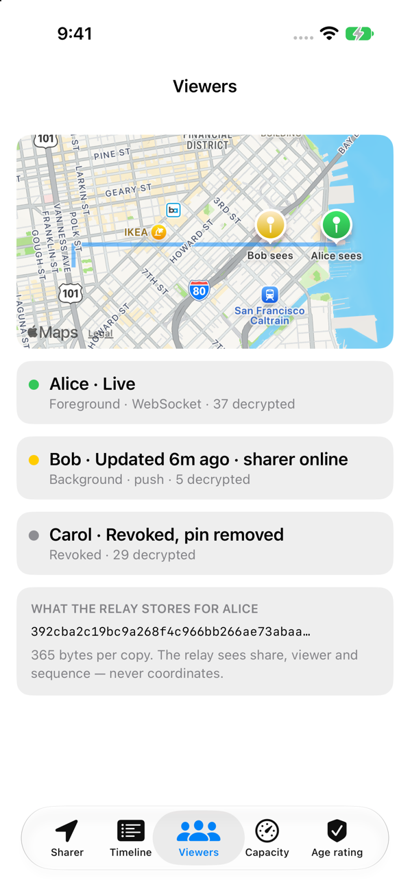

# LiveLocationKit

**"Design live location sharing", answered in Swift that compiles, runs and is tested.**

> **TL;DR** In a 12-minute scripted share, 420 GPS fixes and a heartbeat timer produce 37 points: 32 from fixes and 5 heartbeats sent while parked. Each point goes out as one end-to-end-encrypted copy per viewer (about 365 bytes each), and the relay cannot read any of them. The repo includes 99 tests and 44 planted bugs, each of which a test must catch, plus a capacity estimate for 10 million concurrent shares. It ends with an honest list of what is *not* solved.

**Quick start:** `.package(url: "https://github.com/rajatslakhina/live-location-share-kit.git", from: "2.1.4")`, then see [Use it](#use-it).

The library covers six things:

- **Adaptive publishing:** how often the sharer sends depends on motion and battery.
- **Encryption:** each viewer gets their own end-to-end-encrypted copy, under a sharer key they pinned from the invitation.
- **A relay that keeps only the latest point,** with presence on a TTL.
- **Revocation enforced on the sharer's device,** so it holds for future points even if the relay misbehaves.
- **Budgeted, coalescing background pushes.**
- **An age-rating gate** that keeps the code and its App Store Connect answer in step.

[](https://github.com/rajatslakhina/live-location-share-kit/actions/workflows/ci.yml)
  



**Demo app:** [live-location-share-demo-app](https://github.com/rajatslakhina/live-location-share-demo-app) is a separate Xcode project that consumes this package as a remote Swift package. It requires a version from 2.1.4 up to, but not including, 3.0.0, and its `Package.resolved` pins the exact release. It runs a 12-minute scripted share (walk, then drive, then park) through the core types: session, sealer, relay, inbox, freshness, load model and gate. It was run on the iOS Simulator, and the screenshot comes from that run.

In the run, 420 GPS fixes and the parked-heartbeat timer produced 37 points. Alice watches live over a socket. Bob is backgrounded, so his pin falls behind under the push budget. Carol is revoked halfway through.

## Why this matters now

On 16 Nov 2026 Apple added a **Shared Location** content descriptor to the App Store Connect age-rating questionnaire. It asks whether the app shares a user's real-world location with another person or group. Every app must answer by **12 Jan 2027**, and in Brazil a "Yes" means an **A16** rating. That turns a classic system-design interview question, *design live location sharing*, into a product and compliance problem with a deadline.

The naive build streams GPS at 1 Hz to a server that fans plaintext out to every viewer. That build:

- drains the battery;
- keeps sending the same point from a parked phone;
- lets the server read everyone's location;
- makes "stop sharing with Carol" depend on the server behaving;
- has nothing linking what the code does to what the age-rating form says.

This package is the version you could defend in a design review.

<br clear="right">

## The system

```
SHARER DEVICE
  CoreLocation fix ─▶ PublishPolicy (motion, battery, Low Power Mode → interval, distance, heartbeat)
                   ─▶ PublishGate   (first / moved / heartbeat, or suppress with a reason)
                   ─▶ TokenBucket   (battery budget; heartbeats exempt)
                   ─▶ PerViewerSealer: one padded copy per viewer,
                      X25519 → HKDF(both public keys) → ChaCha20-Poly1305
  CapabilityManifest ─▶ SharerSession refuses to start without .liveLocationSharing
                     └▶ AgeRatingGate checks it against the "Shared Location" answer (demo repo CI)
        │
        ▼  only routing headers (share, viewer, sequence) are readable from here on
RELAY  (LocationRelay actor = one server shard)
  presence TTL · latest copy per (share, viewer) · expiry, stop, revoke · future-sequence guard
  per-viewer push budget, served oldest-waiting first, coalesced to the newest point
        │
        ├─▶ foreground viewer: points stream + separate control stream ─▶ PointInbox
        └─▶ background viewer: budgeted push ───────────────────────────▶ PointInbox
VIEWER DEVICE
  PointInbox: pinned sharer key, replay window, Freshness (live / behind / delayed / stale / offline)
```

| Layer | Type | Tested behaviour |
|---|---|---|
| Rate | `PublishPolicy`, `PublishGate` | Motion sets the cadence: 5 s / 50 m when driving, 60 s when parked. Low battery stretches it 2× or 4×. The heartbeat is at most TTL / 2, every suppressed fix records a reason, and the first point must be accurate. |
| Battery | `TokenBucket` | A per-session budget for movement updates. Heartbeats never spend it. |
| Privacy | `PerViewerSealer`, `PointInbox`, `FanoutAudit` | One padded, sealed copy per viewer, under a sharer key the viewer pinned. The relay cannot read or forge points. Re-addressed, renumbered or replayed copies fail. |
| Revocation | `SharerSession`, `LocationRelay` | Enforced on the sharer's device first. Relay calls for one viewer are single-flight, and a refusal counts only if it answers the exact latest intent, so a late reply can never undo a newer revoke or add. Revokes, adds and stops that fail are retried; adds the relay refuses are reported. |
| Server | `LocationRelay` (actor) | Keeps only the latest copy per (share, viewer), with a presence TTL. Expiry, stop and hard limits apply. Future and stale sequences are dropped. A viewer who leaves their last share is disconnected. |
| Delivery | `connect`, `drainPushes` | Newest-wins point stream plus a separate control stream. Pushes are budgeted, coalesced and served oldest first. |
| Session | `SharerSession` (actor) | Reads the TTL from the relay. Sequences follow the clock, and the session can be restored after a relaunch. It stops when the share is gone. |
| Viewer UI | `Freshness` | Live, behind, delayed, stale, waiting, ended, and "you are offline". |
| Capacity | `FanoutLoadModel` | Publishes, copies, connections, pushes (with and without the budget), bytes and storage for N shares. |
| Compliance | `CapabilityManifest`, `AgeRatingGate` | The manifest gates the session at runtime. Demo CI checks the manifest against the checked-in age-rating answer. |

## Design decisions and the alternatives I rejected

**Heartbeats instead of a stream when parked.**
- A stationary phone publishes only a heartbeat every TTL / 2: the last fix, with a fresh `sentAt`. Viewers see "here, as of 40 s ago", and the relay's presence stays alive.
- One lost heartbeat therefore lands *exactly* at the TTL boundary, so tolerating a loss needs a prompt timer. Timer slack is added to every interval: with the 1 s tick in the snippet below, one lost heartbeat can read as "away" for up to about two seconds (one tick per interval), plus network latency. If that matters, shorten the heartbeat.
- *Rejected:* a fixed 1 Hz stream. In the demo's 12-minute share the sharer sends 37 points, 6 of them heartbeats, where a 1 Hz publisher would send 720.
- *Rejected:* scaling the heartbeat with battery, the way the movement interval scales. That is the bug `testTheCheckCatchesAPolicyWhoseHeartbeatOutlivesTheTTL` feeds in, to prove the presence check is not vacuous.

**One sealed copy per viewer, not one group key.**
- With a shared group key, revoking Carol means re-keying everyone, and until then Carol can read every copy the relay hands her.
- Here each copy is sealed under `HKDF(X25519(shareKey, viewerKey), salt: shareID, info: viewerID ‖ sharerKey ‖ viewerKey)`, and the AEAD tag binds (share, viewer, sequence). Revocation is simply "stop sealing for that key".
- *Cost:* fan-out work and bytes grow with the number of viewers. That is why the load model counts copies rather than publishes, and why viewers per share are capped.
- The group-key scheme is in the tests as a deliberately broken implementation, and `FanoutAudit` must flag it.

**The viewer pins the sharer's key from the invitation.**
- Without a pin, any relay that knows a viewer's public key could mint its own key and seal a valid-looking point.
- *Rejected:* trusting the key carried in each envelope.
- *Rejected:* signing every envelope with an Ed25519 identity key. That would also work, but it needs an identity system the invitation pin does not.
- The forged-copy test includes a control showing the forgery *would* decrypt without the pin.

**Latest-wins everywhere.**
- The relay keeps one copy per (share, viewer), the push queue one pending copy per (viewer, share), and the sharer's offline outbox one batch.
- Location is a *state*, not an event log, so replaying history costs something and buys nothing.
- *Rejected:* a durable queue per viewer, which grows without bound for data that is worthless a minute later.

**A monotonic sequence, assigned before the upload `await`.**
- In `ingest` and `tick`, `SharerSession` decides, spends budget, assigns the sequence, seals and commits, all before uploading. Two overlapping calls therefore get increasing sequences in call order, and if their uploads land out of order the relay drops the older one.
- Sequences start at wall-clock ms × 2¹⁶, so a relaunched app is not mistaken for a replay, unless the device clock moved backwards.
- Sequences also follow the clock: each one is at least wall-clock ms × 2¹⁶. The relay refuses sequences more than 5 minutes ahead of its own clock. A junk copy at `UInt64.max` is rejected outright. In the default mode, one just inside the window blocks a share only until the sharer's clock passes it. Repeating it every few minutes still can; see the limits.
- *Rejected:* server-assigned sequence numbers, which need a round trip before every publish and break offline buffering.
- *Rejected:* ordering by fix timestamp, because CoreLocation re-delivers fixes and heartbeats re-send old ones.

**Budgeted, coalescing pushes, served oldest-first.**
- Background delivery is the expensive path: APNs, plus the on-device Live Activity update budget.
- The relay gives each background viewer a burst plus a sustained rate. A push that waits for budget is replaced by newer points, so it always carries the newest one. The queue serves whichever share has waited longest, so a busy share cannot starve a quiet one.
- *Rejected:* a push for every point. That costs about 20× more at the 5-minute budget the load model uses, and iOS throttles background updates unpredictably anyway.
- *Rejected:* a per-viewer FIFO, which delivers stale points first.
- *Trade-off:* a background viewer's pin can be minutes old. The demo shows Bob in exactly that state, which is why `Freshness` has a **behind** state rather than pretending everything is live.

**One manifest gates the runtime, and CI compares it with the App Store Connect answer.**
- `SharerSession.init` throws `capabilityNotDeclared` unless the manifest contains `.liveLocationSharing`.
- `AgeRatingGate.check` fails CI if the manifest and the exported "Shared Location" answer disagree.
- That keeps the two checked-in files consistent. It cannot see a share feature built without `SharerSession`; see the limits below.
- *Rejected:* a checklist item in the release process, which drifts the first time someone adds a share button.

**The SwiftUI scenario ships in the package (`LiveLocationUI`), not in the app.**
- The demo README quotes the scenario's numbers, so the scenario needs tests.
- A package test target, `LiveLocationUITests`, runs it headlessly and fails if 420 / 37 / 6, Alice's 365-byte copy, or the Alice / Bob / Carol states drift.
- *Rejected:* keeping the scenario in the app target, where package CI cannot test it and the quoted numbers could drift unnoticed.

## From actor to deployment

`LocationRelay` is the state machine one relay shard runs. At **10 million active shares**, with 3 viewers each, the commuting-hour mix and 365-byte copies (the size the demo measures), the model gives these figures. They are pinned by `testTenMillionSharesFiguresQuotedInTheREADME`.

| Quantity | Value |
|---|---|
| Sharer publishes | 675,000 / s |
| Sealed copies accepted | 2,025,000 / s |
| Ingress | ≈ 739 MB / s |
| Foreground (share, viewer) pairs: upper bound on connections | 9,000,000 |
| Background (share, viewer) pairs | 21,000,000 |
| Pushes with a 5-minute budget | 252,000,000 / h (70,000 / s) |
| Latest-only storage | ≈ 11 GB |

How that maps onto infrastructure (assumptions, not measurements):

- **Partition by `ShareID`.** Use consistent hashing, so a share's record, presence, latest copies and expiry all live on one shard. That is exactly the state this actor owns.
- **Share records must be durable and replicated.** If a shard loses one, publishes come back `unknownShare` and sharers end the share. Only latest copies and presence are soft state; sharers rebuild them within TTL / 2.
- **Put a connection tier in front of the shards.** At an assumed 100k WebSockets per gateway node, 9M connections need about 90 nodes. Gateways subscribe to the shards holding their viewers' shares.
- **The budget keeps APNs at 70k/s.** That is within what a pool of HTTP/2 connections handles. Without the budget it would be about 1.4M/s, which is why the budget lives on the server.

## Verification

- **Build and tests:** `swift build -Xswiftc -warnings-as-errors` from a clean `.build`, then `swift test`, locally on macOS with Xcode 27.2. **99 tests, 0 failures**: 97 library tests plus 2 demo-scenario tests.
- **iOS build:** `xcodebuild build` of both library targets for the iOS Simulator SDK, with warnings as errors.
- **Mutation check:** `Scripts/mutation_check.py` plants 44 deliberate bugs, one at a time. Each mutant must compile, and its named test must **fail**. Each named test must also pass when no mutant is applied. Examples of the planted bugs:
  - accepting an equal sequence as new;
  - leaving the sharer-key pin unchecked;
  - dropping the future-sequence guard;
  - removing the revoke-before-await line;
  - re-adding revoked viewers to the outbox;
  - not retrying a failed stop;
  - treating a late refusal of an older add as final;
  - letting a counter sequence fall behind a junk copy;
  - removing the single-flight guard on per-viewer relay calls;
  - clearing an intent that changed while its relay call was in flight;
  - doubling the TTL / 2 heartbeat;
  - dropping the plaintext padding;
  - serving pushes by name instead of age.
- **CI:** all three run on pushes to `main`, on tags and on pull requests, on GitHub's `macos-15` runner with its default Xcode. See the [Actions tab](https://github.com/rajatslakhina/live-location-share-kit/actions).
- **Simulator:** the demo app was built against this package's release tag, resolved from GitHub. It was installed and launched on an iOS Simulator and screenshotted, as described in the [demo repo](https://github.com/rajatslakhina/live-location-share-demo-app#verification-exactly-what-happened).

To run the checks yourself:

```sh
git clone https://github.com/rajatslakhina/live-location-share-kit.git && cd live-location-share-kit
swift test
python3 Scripts/mutation_check.py   # 6–12 min on an Apple-silicon Mac (730 s for this release on a busy machine); runs on a temp copy
```

## Honest limits

**The relay is not a production server.**
- It is an in-process actor: the state machine a server shard would run. There is no HTTP or WebSocket transport, no persistence and no horizontal scaling here; the section above is a design, not an implementation. `RelayUplink` is the seam a network client would implement.
- **There is no relay authentication.** Points stay unreadable and unforgeable, but routing and presence are open:
  - Anyone who can reach the relay can `connect` as another viewer's ID. That steals the viewer's future copies (still encrypted) and clears their queued pushes.
  - Anyone can keep presence alive by publishing.
  - Connections are capped per viewer (`maxConnectionsPerViewer`) and only allowed for viewers on a share, but without authentication anyone can use up a real viewer's connection slots.
  - Anyone can publish a junk copy whose sequence sits up to 5 minutes ahead of now. In the default clock-driven mode, that blocks genuine copies for that viewer for up to 5 minutes, plus clock skew, until the sharer's sequence passes it. With an explicit `startingSequence` (counter mode), it blocks that viewer for the rest of the session. Re-posting it every few minutes keeps the share blocked indefinitely. Each junk copy also displaces a background viewer's pending push, so the viewer receives junk (which fails to decrypt) instead of the real point.
  - Anyone who knows a `ShareID` can stop the share, revoke any viewer, or add viewers up to `maxViewersPerShare`. Anyone can start shares until `maxActiveShares` (global) is used up.
  - Presence is unauthenticated, and that reaches the viewer UI: anyone who keeps a share's presence alive makes a sharer who went quiet read as **behind · sharer online** instead of **Last seen**.
  - Mitigation in production: share-scoped publish tokens and authenticated sharer and viewer sessions.
- **A sharer whose clock runs more than 5 minutes ahead of the relay's** has every copy rejected as `futureSequence`.
  - After a sharer's clock has run more than 5 minutes fast and is then corrected, its clock-driven sequence stays high. Copies are rejected as `futureSequence` until real time catches up, not just while the clock is wrong.
- **Relay calls assume a failed call was never applied.** Relay revokes and adds for one viewer are single-flight: one call is in the air at a time, and the session then sends whatever the latest intent is. This converges *provided* a call reported as failed was not applied later by the relay (for example, a timed-out request delivered late). An HTTP client should give these calls deadlines and make them idempotent: per the `RelayUplink` contract, `revoke` and `stop` for a share the relay has forgotten must succeed or throw `RelayError.unknownShare`, or the session keeps retrying them.

<details><summary><b>What the crypto does and does not cover</b></summary>

- **Key distribution is out of scope.** The sharer's key travels with the invitation, and viewer keys come from the account system; both are assumed authentic. Production would add key transparency or safety-number verification.
- **The relay still sees metadata:**
  - who shares with whom, when, and how often;
  - the sharer device's clock at every send, to the millisecond, from the clock-driven sequence;
  - coarse motion and battery state, from the publish cadence (5, 10, 15, 30 or 60 s intervals; 2× or 4× stretch).
  Padding removes the length signal, but heartbeats stay identifiable from their timing.
- **No sender signature (key-compromise impersonation).** Static-static X25519 means that whoever steals a viewer's private key can also forge sharer points *to that viewer*. Signing each envelope with Ed25519, the rejected alternative above, would close this gap.
- **Forward secrecy is limited.** There is one X25519 key per share, so compromising it exposes that share's copies. Compromising a viewer's long-term key exposes every share ever sent to that viewer.
- **Viewer replay state lives in memory.** `PointInbox` rejects replays only within one app process.

</details>

<details><summary><b>State the app must handle itself</b></summary>

- **Relaunch needs app-side persistence.** The app must persist the share key, the viewer list, `unacknowledgedRevocations`, `unacknowledgedAdds` and `stopUnacknowledged`, and re-apply them after a relaunch. A pending add that the relay later refuses during `flushOutbox` is dropped and listed in `refusedAdds`, so the app should check it and update its own viewer list. The battery budget and the publish gate start fresh after a relaunch.
- **Freshness compares the sharer's clock with the viewer's.** Clock skew between devices can misreport live versus stale.

</details>

<details><summary><b>Push budgets</b></summary>

- **Push budgets outlive revocation only until they refill.** A viewer left on no share keeps their bucket until it has fully refilled, then loses it, which keeps memory bounded. Revoke-and-re-add cannot reset a burst; a viewer who returns after a full refill period starts with a full burst, which is what they would have anyway.
- **There is no real APNs or ActivityKit.** `drainPushes()` returns what a sender would hand to APNs. Apple's on-device Live Activity budgets are not modelled.
- **The demo uses a 6-minute push refill, so its push numbers differ from the README's.** The longer refill makes Bob's last push land mid-drive and leaves him visibly behind. The demo's capacity tab therefore shows 21,000 pushes/h (about 24× fewer than unbudgeted), where the README's figures assume a 5-minute refill (about 20×).

</details>

<details><summary><b>Other gaps</b></summary>

- **`LiveUpdatesSource` compiles but is not exercised.** This `CLLocationUpdate.liveUpdates` adapter is used by neither the tests nor the demo, which drives a scripted route. Authorization prompts, background modes and a significant-change fallback are the app's job and are not implemented.
- **The load model is an estimate.** It assumes full battery and that moving sharers clear the distance threshold every interval. It also ignores the per-session movement budget: with the defaults (120-update burst, one refill per 30 s), a driver falls from one update per 5 s to one per 30 s after about 12 minutes, so sustained driving load is overestimated by up to about 6×. All of this overestimates load, which is the right direction for capacity planning. It counts messages and bytes, not CPU.
- **The age-rating gate checks only the two files it is given.** Any code can construct a manifest that claims the capability. A share feature built without `SharerSession` is invisible to the gate. `age-rating.json` is maintained by hand, the gate covers one descriptor, and it does not call the App Store Connect API.

</details>

## Use it

```swift
.package(url: "https://github.com/rajatslakhina/live-location-share-kit.git", from: "2.1.4")
```

**Sharer:**

```swift
import LiveLocation

// Placeholders from your app:
//   aliceID / aliceKey: Alice's viewer ID and public key (Data), from your account system
//   manifestURL:        your bundled capabilities.json
let relay = LocationRelay(configuration: RelayConfiguration(presenceTTL: .seconds(120)))  // a server shard in production
let share = ShareID(UUID().uuidString)                  // random: the relay can read share IDs
try await relay.startShare(share, viewers: [aliceID], duration: .hours(1))

var sealer = PerViewerSealer(shareID: share)            // persist sealer.privateKeyRaw in the Keychain
try sealer.add(aliceID, publicKey: aliceKey)            // send sealer.sharePublicKey to Alice in the invitation
let manifest = try CapabilityManifest.decode(Data(contentsOf: manifestURL))
let session = try SharerSession(shareID: share, manifest: manifest, sealer: sealer,
                                uplink: relay, clock: SystemClock())

// A 1 s timer: heartbeats keep presence alive when CoreLocation goes quiet; the flush retries the
// offline outbox and any revoke or stop that failed — including after the share ends.
let timer = Task {
    while !Task.isCancelled {
        try await Task.sleep(for: .seconds(1))
        _ = await session.tick(conditions: DeviceConditions(batteryLevel: 0.8, motion: .stationary))
        _ = await session.flushOutbox()
        if await session.isEnded, !(await session.stopUnacknowledged),
           (await session.unacknowledgedRevocations).isEmpty { break }    // relay has everything; done
    }
}
for await fix in LiveUpdatesSource.fixes(for: .walking) {             // until the user taps Stop
    if await session.ingest(fix, conditions: DeviceConditions(batteryLevel: 0.8, motion: .walking)) == .ended { break }
}
await session.stop()                                                // the timer keeps retrying until acknowledged
```

**Viewer:**

```swift
// Placeholders: aliceKeys (Alice's ViewerKeys, restored from the Keychain); invitationKey (the sharer key from the invitation).
@MainActor final class Pins {
    var inbox: PointInbox
    init(_ inbox: PointInbox) { self.inbox = inbox }
}
var inbox = PointInbox(opener: PerViewerOpener(keys: aliceKeys))
inbox.trust(share, sharerPublicKey: invitationKey)
let pins = await Pins(inbox)
let connection = try await relay.connect(aliceID)
Task { @MainActor in
    for await event in connection.control {             // revoked / ended: remove the pin
        switch event { case .revoked(let s), .ended(let s, _): pins.inbox.forget(s) }
    }
}
Task { @MainActor in
    for await copy in connection.points {
        if let point = try? pins.inbox.receive(copy) { _ = point /* move the pin; show Freshness for point.sentAt */ }
    }
}
```

Release history: [CHANGELOG.md](CHANGELOG.md).

Products: `LiveLocation` (the core, no UI) and `LiveLocationUI` (the SwiftUI scenario the demo app shows). Requires iOS 17+ or macOS 14+, Swift 6 language mode.

MIT licensed.
